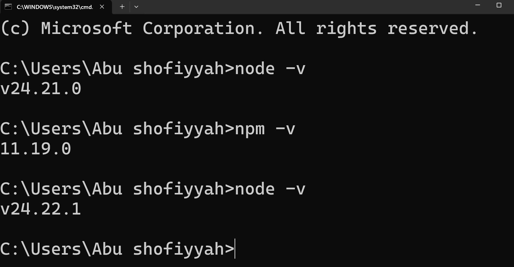
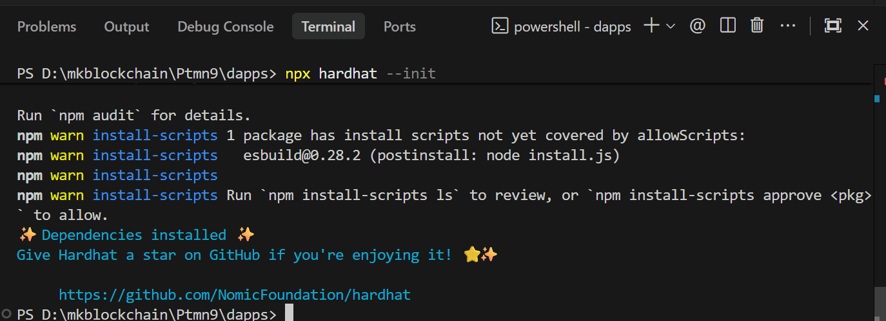
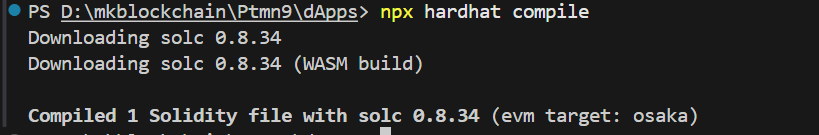
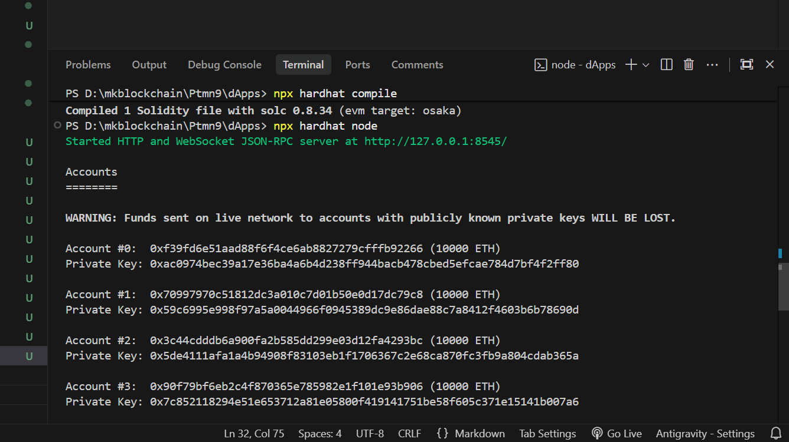
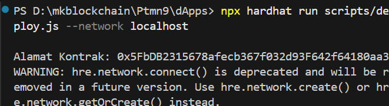
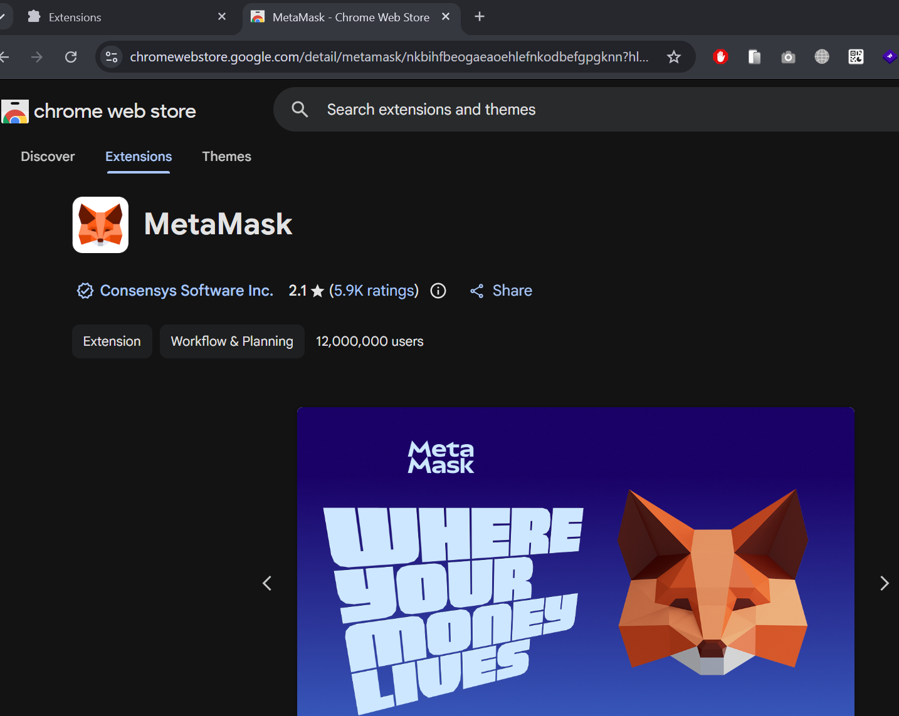
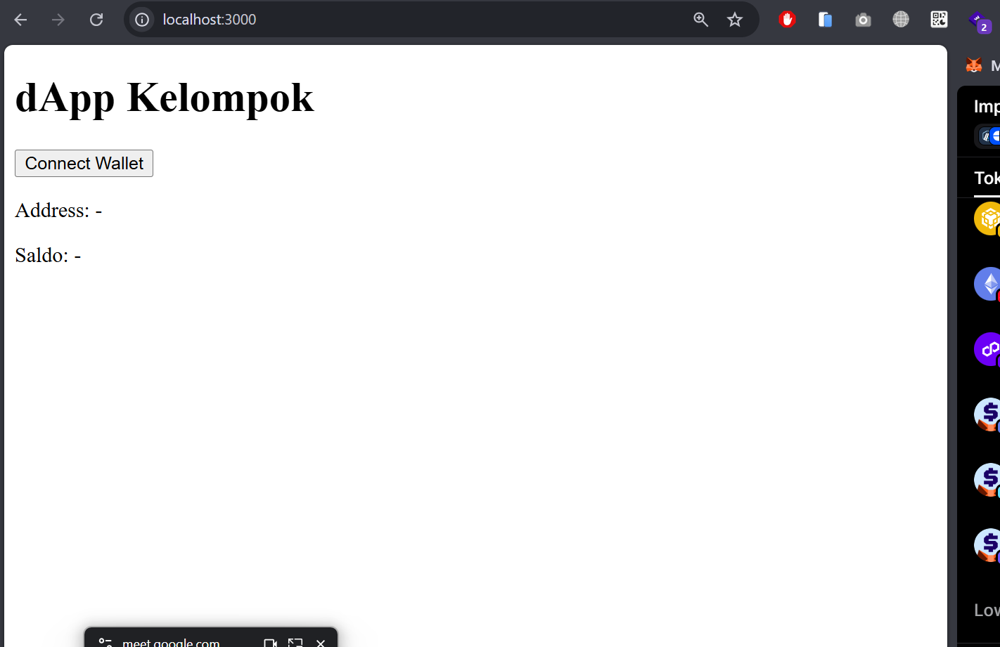
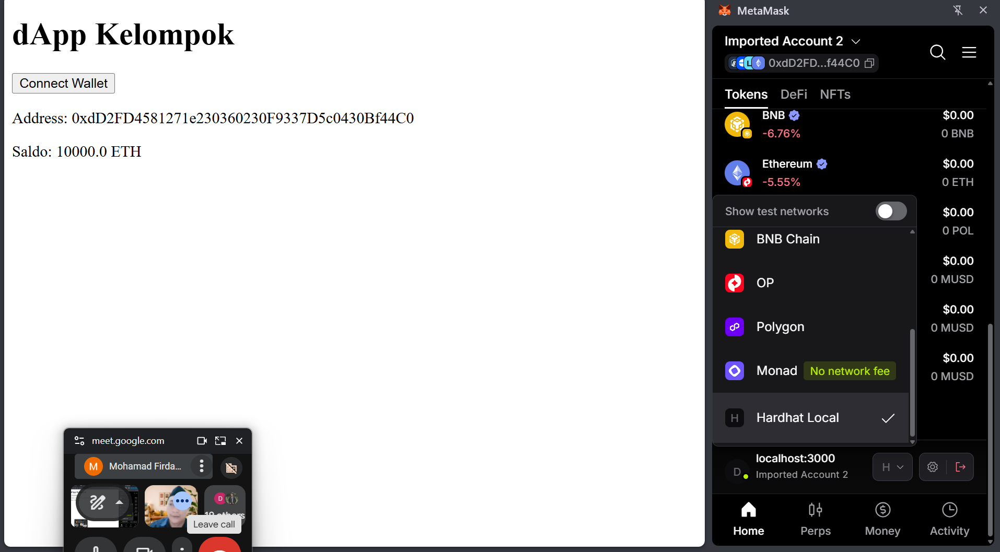

# INTEGRASI FRONT END DAN WEB3 #

## Langkah Praktikum ##

1. Cek Instalasi Node dan NPM (node -v, npm -v)
2. Jika belum tersedia instal via https://nodejs.org/en/download
3. bukti node Js dan NPM



4. Buat Folder baru nama dApps
5. Open Terminal dan CD ke dalam folder tersebut
    ```bash
    mkdir dApps
    cd dApps
    ```
6. Inisialisasi npm 
    ```bash
    npm init -y
    ```
7. Install Framework Hardhat 
npm install --save-dev hardhat

8. Menjalakan Hardhat (npx hardhat --init )


9. Unduh dan tempatkan File smart contract yang sudah dibuat di Remix ke Folder Contracts   

10. Compile Projek dAPps dengan perintah ( npx hardhat compile)


11. Menjalankan Node untuk mendapatkan aktor dan address (npx hardhat node)



12. Membuat file deploy.js di folder scripts
13. Deploy node ke Local npx hardhat run scripts/deploy.js --network localhost

14. Membuat File index.html
15. Install ekstension Meta mask

16. Login / Create Akun Via Oauth GMail
17. Create Custom Network dengan nama Hardhat Local
18. Import Custom account via private key (Private key di dapat di terminal VScode)
19. Jalankan Index.html (npx serve .)

20. Hasil sudah Konek 
